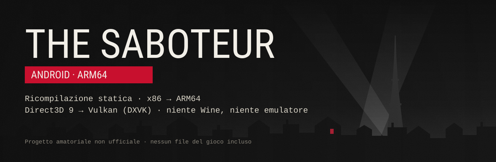
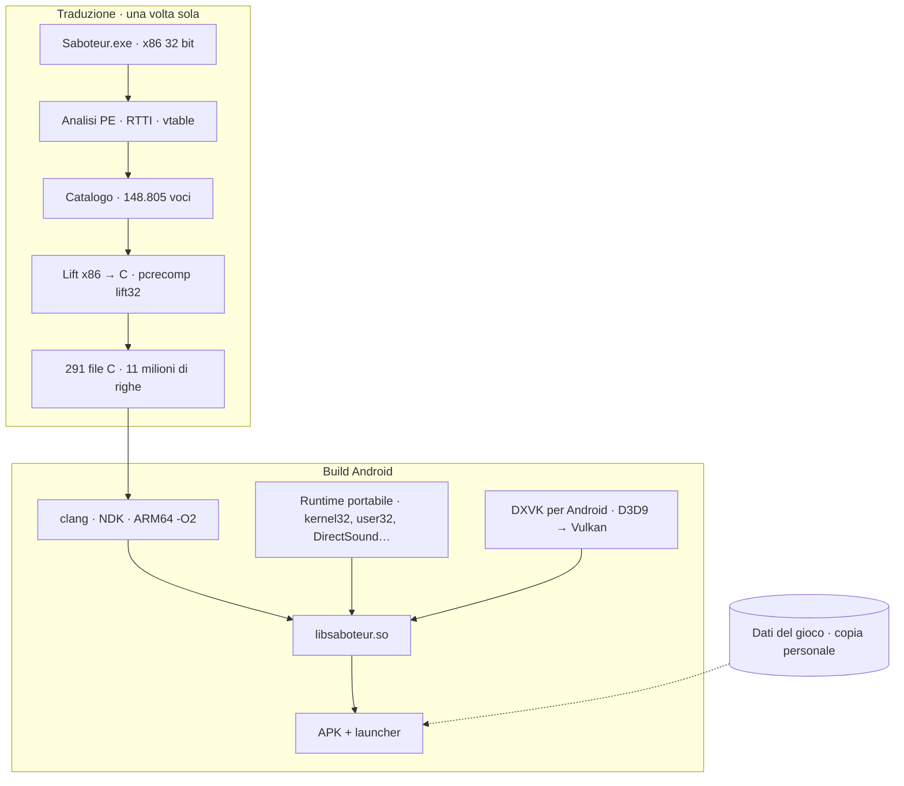

# The Saboteur per Android — ricompilazione statica

**Il codice originale di *The Saboteur* (PC, 2009) tradotto da x86 a 32 bit ad ARM64 nativo. Niente Wine, niente Box64, niente emulazione mentre giochi.**

[-ac162c?logo=vulkan&logoColor=white)](#6-grafica-direct3d-9--vulkan)

🇮🇹 Italiano · [🇬🇧 English](README_EN.md)

> [!IMPORTANT]
> Progetto amatoriale e **non ufficiale**, senza legami con Electronic Arts o Pandemic Studios.
> Questo repository **non contiene e non conterrà mai** file del gioco, l'eseguibile originale o
> codice generato a partire da esso. Per giocare servirà sempre **la propria copia PC** del gioco
> (la versione di riferimento è quella GOG).

---

## Indice

- [In breve](#in-breve)
- [Stato del progetto](#stato-del-progetto)
- [Perché la ricompilazione statica](#perché-la-ricompilazione-statica)
- [Come funziona](#come-funziona)
  - [1. Analisi dell'eseguibile](#1-analisi-delleseguibile)
  - [2. Catalogo delle funzioni](#2-catalogo-delle-funzioni)
  - [3. Traduzione x86 → C](#3-traduzione-x86--c)
  - [4. Prova su PC](#4-prova-su-pc)
  - [5. Runtime Android: un "Windows senza Windows"](#5-runtime-android-un-windows-senza-windows)
  - [6. Grafica: Direct3D 9 → Vulkan](#6-grafica-direct3d-9--vulkan)
  - [7. Audio, input e filmati](#7-audio-input-e-filmati)
  - [8. Launcher e comandi touch](#8-launcher-e-comandi-touch)
- [Prestazioni](#prestazioni)
- [Dispositivi di prova](#dispositivi-di-prova)
- [Requisiti (previsti)](#requisiti-previsti)
- [Roadmap](#roadmap)
- [Diario dei traguardi](#diario-dei-traguardi)
- [Sostieni il progetto](#sostieni-il-progetto)
- [Ringraziamenti e software di terze parti](#ringraziamenti-e-software-di-terze-parti)
- [Note legali](#note-legali)

---

## In breve

*The Saboteur* è l'open world di Pandemic Studios ambientato nella Parigi occupata del 1940, famoso
per il bianco e nero con il rosso. Su PC esiste solo come eseguibile Windows x86 a 32 bit con
Direct3D 9: per farlo girare su un telefono di solito si usano Wine più un traduttore di codice
(Box64/FEX), che convertono le istruzioni **mentre si gioca**.

Questo porting segue un'altra strada, la stessa del port Android di Metro 2033 e di
[NFSU2 Recompiled](https://github.com/codepdbh/nfsu2-recompiled):

1. `Saboteur.exe` viene analizzato e **tradotto una volta sola in C** (≈148.800 funzioni, 11 milioni di righe);
2. quel C viene **compilato per ARM64** con l'NDK di Android, come qualsiasi programma nativo;
3. al posto di Windows c'è un **runtime scritto apposta** che implementa solo le funzioni che il gioco usa davvero;
4. **Direct3D 9 diventa Vulkan** grazie a DXVK, l'audio esce da AAudio, i comandi arrivano da touch e pad;
5. il tutto è un **APK dedicato** con un launcher a tema; i dati del gioco si copiano dalla propria installazione PC.

| | Wine + Box64 (Winlator, GameNative…) | Questo porting |
| --- | --- | --- |
| Traduzione del codice x86 | mentre giochi (JIT) | una volta, prima dell'installazione |
| Codice eseguito | x86 tradotto al volo | ARM64 nativo ottimizzato da clang |
| Strato Windows | Wine completo | solo le ~240 funzioni usate dal gioco |
| Grafica | DXVK/WineD3D dentro Wine | DXVK nativo per Android, con patch per gli Adreno |
| Installazione | app generica + configurazione | un APK dedicato al gioco |

---

## Stato del progetto

*Aggiornato al 13 novembre 2026.*

| Fase | Contenuto | Stato |
| --- | --- | --- |
| **0** | Strumenti, analisi dell'eseguibile, catalogo delle funzioni | ✅ completata |
| **1** | Traduzione in C e prova su PC Windows | ✅ completata: gioco tradotto **giocabile su PC**, 25–38 fps |
| **2** | Runtime Android ARM64, grafica Vulkan, audio | 🔧 in corso: **in partita a Parigi** su Galaxy S24 Ultra |
| **3** | Launcher e comandi touch | 🔧 in corso: launcher, impostazioni e pad touch funzionanti |
| **4** | Prestazioni | ⏳ iniziata in parallelo alla fase 2 |

### Cosa funziona già sul telefono

- ✅ avvio, menu principale, caricamento delle partite e **gioco libero per Parigi**
- ✅ **audio** (Wwise, tramite DirectSound ricostruito → AAudio a 48 kHz)
- ✅ grafica completa: risoluzione nativa dello schermo, texture alte, **post-processing** (il bianco e nero con il rosso)
- ✅ personaggi animati correttamente e città disegnata a strati (vicino / medio / lontano) senza difetti
- ✅ **pad virtuale sullo schermo** e **pad Bluetooth** (XInput)
- ✅ uscita con il tasto Home e ritorno al gioco senza perdere la partita
- ✅ cache delle pipeline Vulkan: dal secondo avvio niente ricompilazioni
- ✅ launcher dedicato con impostazioni video equivalenti a `VideoSetup.exe`

### Cosa resta da fare

- 🔧 **fluidità**: 15–22 fps nelle strade più pesanti, 23–31 negli interni (obiettivo: 30 stabili)
- 🔧 attese sui buffer della GPU quando il post-processing è attivo
- 🔧 filmati Bink (per ora vengono saltati)
- 🔧 schermi più larghi di 16:9: un elemento dell'HUD fuori bordo resta visibile (si passerà al 16:9 con bande)
- ⏳ prova su GPU più vecchie con Vulkan 1.1 (RedMagic 5G / Adreno 650)
- ⏳ editor della disposizione dei comandi e giroscopio

---

## Perché la ricompilazione statica

- **Velocità.** Il codice del gioco diventa ARM64 vero, ottimizzato dal compilatore, senza il costo
  di tradurlo durante la partita. Il tempo del processore va al gioco, non al traduttore.
- **Controllo.** Ogni funzione di Windows che il gioco chiama passa da codice nostro: si può
  misurare, correggere e adattare al telefono (thread, attese, file, grafica).
- **Esperienza da app.** Un APK, un'icona, un launcher. Niente container, niente configurazioni di Wine.
- **Il prezzo:** è un lavoro molto più lungo, specifico per un solo eseguibile, e ogni errore del
  traduttore va trovato e corretto a mano.

---

## Come funziona

### 1. Analisi dell'eseguibile

Il primo passo è capire con cosa si ha a che fare. Numeri principali di `Saboteur.exe` (versione GOG):

| Cosa | Valore |
| --- | --- |
| Formato | PE32, x86 a 32 bit, *Large Address Aware*, compilato l'11/12/2009 con MSVC 2005 |
| Codice | ≈4,5 milioni di istruzioni (`.text` + `.secu`) |
| Classi C++ | 2.794 con informazioni RTTI |
| Virgola mobile | **x87 dominante**: 652.000 istruzioni, contro 27.000 SSE |
| Librerie integrate | Havok 6.5, Wwise, Lua (collegate staticamente) |
| Import | 13 DLL, 285 funzioni (kernel32, user32, gdi32, d3d9, d3dx9, dinput8, xinput, binkw32…) |
| Thread | molti: ≈8.600 usi di sezioni critiche, 3.179 accessi TLS |
| Eccezioni | SEH ovunque: 2.729 gestori SafeSEH, 8.902 accessi a `fs:` |
| Particolarità | sezione `.secu` **eseguibile e scrivibile**: codice vero, 142.000 istruzioni, raggiunto da 919 salti in `.text` |
| Dati del gioco | ≈7,7 GB (di cui ≈1,4 GB di doppiaggi), DLC *Midnight Show* compreso |

### 2. Catalogo delle funzioni

Per tradurre un programma bisogna sapere dove inizia ogni funzione. Partendo dall'entry point e dai
"semi" ricavati da RTTI e vtable (≈22.400 metodi virtuali), il catalogo è stato completato in più giri:

- puntatori a funzione scritti nel codice e nelle tabelle dei dati;
- inizi di funzione dopo il riempimento `int3` (≈40.400 funzioni mai chiamate direttamente);
- rami delle *jump table*, comprese quelle usate con **indice negativo** dalla `memcpy` della CRT;
- funzioni il cui indirizzo il gioco **calcola mentre gira**, recuperate dai log delle chiamate irrisolte.

Risultato: **148.805 voci**, con `.text` e `.secu` coperte, e **zero chiamate irrisolte** in partita.

### 3. Traduzione x86 → C

Il traduttore è `lift32` di [pcrecomp](https://github.com/sp00nznet/pcrecomp): la CPU x86 diventa una
struttura in C, lo stack x87 è gestito a 80 bit, SSE/SSE2 sono supportati. Sopra ci sono le correzioni
fatte per questo gioco:

- **alias ripiegati**: gli ingressi a metà funzione venivano ricopiati fino a 208 volte; ora la funzione
  si traduce una volta sola con uno *switch* d'ingresso. Il C è passato da **2 GB a ≈0,5 GB**;
- salti `jecxz`/`loop` verso indirizzi che non sono etichette;
- il **"ritorno al nonno"** della CRT matematica (`_CIexp`), che salta un livello di chiamata con
  `pop` + `ret` e che in C non ha un equivalente diretto;
- code di chiamate tra pezzi di funzione che altrimenti consumavano lo stack all'infinito;
- registri locali invece che globali, così il compilatore può ottimizzare davvero.

| Risultato del lift | |
| --- | --- |
| Funzioni tradotte | 148.805 (di cui 40.459 alias ripiegati in 7.286 funzioni) |
| C generato | 291 file, 11.037.561 righe, 554 MB |
| Errori di traduzione | **0** |
| Istruzioni non implementate | 227, quasi tutte in zone di dati scambiate per codice |
| Tempo | ≈2 minuti per rigenerare tutto |

### 4. Prova su PC

Prima di passare al telefono, lo stesso C è stato compilato per **Windows x86**, collegando le import a
Windows vero. È il modo più rapido per trovare gli errori del traduttore, perché si può confrontare
tutto con il gioco originale.

Tappe: immagine mappata e 285 import collegate → finestra e dispositivo Direct3D → primo fotogramma →
menu principale → **partita a Parigi giocabile**. Una patch a pcrecomp rende lo stato della CPU
tradotta **per thread**, così i thread del gioco girano davvero in parallelo: menu da 9 a 33–35 fps
(**×3,7**), in partita **25–38 fps**, sessioni di oltre 5 minuti senza crash.

### 5. Runtime Android: un "Windows senza Windows"

Sul telefono non c'è Windows, quindi le funzioni che il gioco chiama sono state riscritte da zero
(sul modello di NFSU2 Recompiled, ma **senza un lucchetto globale**: i thread del gioco restano paralleli
anche su Android). Un inventario fatto durante 13 minuti di gioco ha mostrato quali servono davvero:
**240 funzioni**.

- **Memoria**: 4 GB riservati per il gioco, puntatori a 32 bit sopra una base; loader del PE; dispatch
  delle chiamate indirette con tabella hash.
- **kernel32**: thread veri con TEB e TLS per thread, sezioni critiche su *futex*, eventi e semafori con
  risveglio mirato, operazioni `Interlocked` atomiche, heap, `VirtualAlloc`, tempo, file con percorsi
  senza distinzione tra maiuscole e minuscole.
- **user32/gdi32** minimi (la "finestra" è la superficie Android), **registro** in memoria con le chiavi
  dell'installazione GOG, `CPUID` che risponde come una CPU con SSE–SSSE3.
- **Stato della CPU tradotta** in un unico blocco per thread raggiunto con lo slot TLS riservato alle app:
  niente chiamate a ogni ingresso di funzione (prima costavano fino al 30% del tempo).
- **Ottimizzazioni per i telefoni**: `Sleep(1)` brevi nei cicli d'attesa del motore, thread del gioco sui
  core grandi, sessione di prestazioni di Android (ADPF) per tenere alta la frequenza.

Per sviluppare più in fretta c'è anche un **banco di prova Linux x86-64**: lo stesso runtime, con un
dispositivo grafico "nullo", arriva fino al ciclo principale del gioco a 60 fps e permette di riprodurre
molti problemi senza installare l'APK.

### 6. Grafica: Direct3D 9 → Vulkan

Il gioco parla Direct3D 9 con oggetti COM a 32 bit; un **ponte COM** (adattato da NFSU2 Recompiled) li
collega a **DXVK native 1.9.2b** compilato per Android. Sopra ci sono patch nate dai problemi visti sul
telefono:

| Problema sul telefono | Causa | Soluzione |
| --- | --- | --- |
| Personaggi rigidi, pezzi del corpo staccati | l'Adreno 750 non supporta i formati di vertice `USCALED/SSCALED` usati per gli indici delle ossa | emulazione in DXVK: lettura come UNORM/SNORM e conversione nello shader |
| Una superficie grigia sopra strade e piazze | i piani di taglio che separano gli strati della città non venivano applicati dal driver | piani convertiti in **fette di profondità** nel vertex shader, senza `gl_ClipDistance` |
| Terreno vicino con vertici sbagliati | segno di `SHORT2/SHORT4` | conversione corretta |
| Rallentamenti nei caricamenti | il gioco blocca interi buffer da 1 MB per scriverne un pezzetto | copie permanenti nella memoria del gioco e invio alla GPU **solo della parte cambiata** |
| 11–30 ms persi a ogni fotogramma | l'esposizione automatica legge subito un pixel dalla GPU | **lettura in ritardo** di tre fotogrammi, senza aspettare la GPU |
| Scatti alla prima visita delle zone | pipeline Vulkan ricompilate a ogni avvio | cache delle pipeline su memoria del telefono |
| Gioco bloccato dopo il tasto Home | `Reset` a schermo intero senza finestra | dispositivo sempre "in finestra" e gestione del dispositivo perso come su Windows |

### 7. Audio, input e filmati

- **Audio**: Wwise è dentro l'eseguibile e usa DirectSound; il runtime ricostruisce DirectSound con un
  mixer che esce su **AAudio** a 48 kHz.
- **Input**: DirectInput 8 e XInput ricostruiti, alimentati dal pad virtuale e dai pad Bluetooth.
- **Filmati**: Bink è sostituito da un decoder "vuoto" che il gioco chiude regolarmente; il supporto
  vero ai filmati è in programma.
- **Rete**: `ws2_32` è importata ma il gioco non la usa mai.

### 8. Launcher e comandi touch

- **Launcher** a tutto schermo con immagini a rotazione, pulsante *Gioca* e un foglio laterale con tre
  sezioni: **Video**, **Comandi**, **Diagnostica**.
- **Impostazioni video** con le stesse voci di `VideoSetup.exe` (che è un programma .NET per Windows e su
  Android non può girare): ombre, distanza visiva, qualità di texture, oggetti e "fette" della città,
  post-processing, profili basso/medio/alto, più la **risoluzione di disegno** al 100, 75 o 50%.
- **Pad virtuale** in stile Xbox: levetta sinistra fissa, visuale trascinando sulla destra, A/B/X/Y,
  dorsali e grilletti, croce, L3/R3, Back/Start, velocità della visuale regolabile.
- **Pad Bluetooth** riconosciuti come controller XInput.

---

## Prestazioni

Misure sul **Samsung Galaxy S24 Ultra** (Snapdragon 8 Gen 3), profilo video basso, distanza visiva alta:

| Situazione | Fotogrammi al secondo |
| --- | --- |
| Interni (Belle) | 23–31 |
| Strade, zone normali | 21–26 |
| Strade, zone pesanti (3.000–4.800 disegni per fotogramma) | 15–22 |
| Con post-processing attivo | 12–14 (in miglioramento) |

Da dove si è partiti: 13–16 fps nella prima versione giocabile sul telefono. Gli strumenti integrati
(profilo a campioni per thread, tempi di Direct3D per metodo, attese per oggetto, tempo "in coda" dei
thread, frequenza dei core) mostrano che oggi il limite non è il calcolo ma la catena di attese tra i
thread del gioco e la frequenza a cui Android tiene i core grandi: è lì che si lavora adesso.

---

## Dispositivi di prova

| Telefono | SoC | GPU | Vulkan | Stato |
| --- | --- | --- | --- | --- |
| Samsung Galaxy S24 Ultra | Snapdragon 8 Gen 3 | Adreno 750 | 1.3 | ✅ giocabile |
| RedMagic 5G | Snapdragon 865 | Adreno 650 | 1.1 | ⏳ da provare |

---

## Requisiti (previsti)

Indicativi, possono cambiare prima di una versione pubblica:

- una **copia PC di The Saboteur** (riferimento: GOG), con ≈7,7 GB di dati da copiare sul telefono;
- **Android 10 o successivo**, processore **ARM64**, GPU con **Vulkan**;
- un SoC di fascia alta recente (classe Snapdragon 8 Gen 2/Gen 3) per giocare in modo fluido;
- facoltativo: un controller Bluetooth.

---

## Roadmap

- [x] Catalogo completo delle funzioni (`.text` + `.secu`)
- [x] Traduzione completa in C senza errori
- [x] Gioco tradotto giocabile su PC, thread in parallelo
- [x] Runtime portabile e banco di prova Linux
- [x] Primo avvio su Android, audio, partita a Parigi
- [x] Personaggi, mappa e post-processing corretti sugli Adreno
- [x] Pad virtuale, pad Bluetooth, launcher con impostazioni video
- [ ] 30 fps stabili in strada sull'S24 Ultra
- [ ] Post-processing senza perdita di fluidità
- [ ] Filmati Bink
- [ ] Formato 16:9 con bande e HUD corretto sugli schermi larghi
- [ ] GPU con Vulkan 1.1 (Adreno 650 e simili)
- [ ] Editor della disposizione dei comandi, giroscopio

---

## Diario dei traguardi

| Data | Traguardo |
| --- | --- |
| 9 nov 2026 | Analisi di `Saboteur.exe`, catalogo completo, primo lift senza errori |
| 9 nov 2026 | Primo avvio del gioco tradotto su PC, primo fotogramma, menu principale |
| 9 nov 2026 | Thread in parallelo (×3,7) e **partita a Parigi su PC** |
| 9 nov 2026 | Runtime portabile: il gioco gira senza Windows sul banco di prova Linux |
| 10 nov 2026 | **Primo avvio sul telefono**; filmato, audio, menu; **in partita a Parigi** |
| 10 nov 2026 | Pad virtuale, impostazioni grafiche, personaggi corretti sull'Adreno 750 |
| 11 nov 2026 | Città a strati corretta (fette di profondità), lettura in ritardo, impostazioni video |
| 11 nov 2026 | Stato della CPU in un blocco per thread, attese mirate: da 15 a 23–31 fps negli interni |
| 12–13 nov 2026 | Launcher rifatto, profilo delle prestazioni per thread, ottimizzazioni Android |

---

## Sostieni il progetto

Questo è un progetto fatto nel tempo libero. Se ti piace l'idea di giocare *The Saboteur* sul telefono
in modo nativo, puoi offrirmi un caffè su Ko-fi: aiuta a coprire il tempo di sviluppo e i dispositivi di prova.

Una donazione è un sostegno allo sviluppo: **non** dà diritto a una copia del gioco né a file del gioco.
Anche una ⭐ al repository aiuta a far conoscere il progetto.

---

## Ringraziamenti e software di terze parti

- **[pcrecomp](https://github.com/sp00nznet/pcrecomp)** di sp00nz (MIT): analisi dei PE, catalogo, traduttore
  `lift32`, host `native32` per la prova su Windows.
- **[NFSU2 Recompiled](https://github.com/codepdbh/nfsu2-recompiled)** di codepdbh (MIT): il riferimento per
  il lato Android: ponte COM di Direct3D 9, DXVK per Android, AAudio, comandi touch.
- **[DXVK](https://github.com/doitsujin/dxvk)** / **[dxvk-native](https://github.com/Joshua-Ashton/dxvk-native)**
  di Philip Rebohle e Joshua Ashton (licenza zlib): Direct3D 9 → Vulkan.
- **[Capstone](https://www.capstone-engine.org/)**, **[pefile](https://github.com/erocarrera/pefile)**,
  **[LIEF](https://lief.re/)** e **[Unicorn](https://www.unicorn-engine.org/)** per l'analisi.
- Il port Android di *Metro 2033* come ispirazione per il metodo e per il launcher.

---

## Note legali

*The Saboteur* è © Electronic Arts Inc. Sviluppato da Pandemic Studios. Havok, Wwise e Bink sono marchi
dei rispettivi proprietari. Tutti i marchi citati appartengono ai legittimi proprietari.

Questo è un progetto amatoriale di interoperabilità, **non affiliato, approvato o sponsorizzato** da
Electronic Arts o da altri titolari dei diritti. Il repository non distribuisce file del gioco,
l'eseguibile originale né codice derivato da esso. Il gioco si compra su
[GOG](https://www.gog.com/) o negli altri negozi ufficiali.
