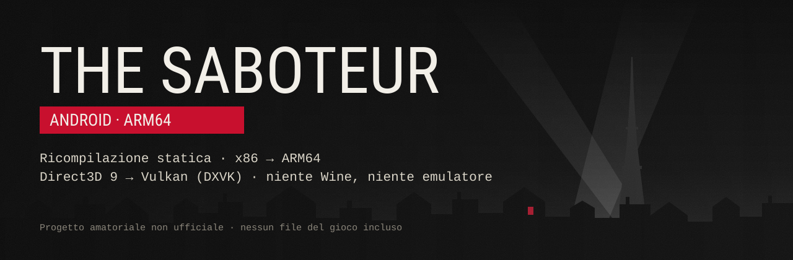
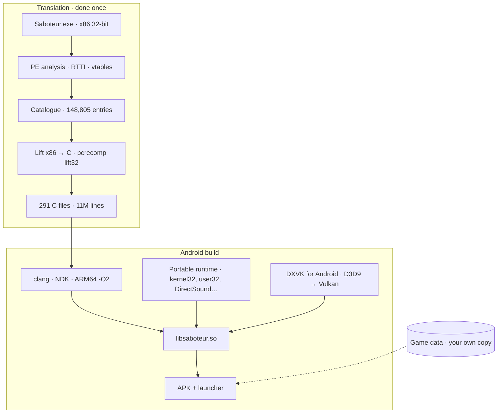

# The Saboteur for Android — static recompilation

**The original code of *The Saboteur* (PC, 2009) translated from 32-bit x86 to native ARM64. No Wine, no Box64, no emulation while you play.**

[-ac162c?logo=vulkan&logoColor=white)](#6-graphics-direct3d-9--vulkan)

[🇮🇹 Italiano](README.md) · 🇬🇧 English

> [!IMPORTANT]
> This is an unofficial **fan project**, not affiliated with Electronic Arts or Pandemic Studios.
> This repository **does not and will never contain** game files, the original executable, or code
> generated from it. You will always need **your own PC copy** of the game (the reference version is GOG's).

---

## Contents

- [At a glance](#at-a-glance)
- [Project status](#project-status)
- [What's new on 13 November](#whats-new-on-13-november)
- [Why static recompilation](#why-static-recompilation)
- [How it works](#how-it-works)
  - [1. Analysing the executable](#1-analysing-the-executable)
  - [2. Function catalogue](#2-function-catalogue)
  - [3. Lifting x86 to C](#3-lifting-x86-to-c)
  - [4. PC test build](#4-pc-test-build)
  - [5. Android runtime: "Windows without Windows"](#5-android-runtime-windows-without-windows)
  - [6. Graphics: Direct3D 9 → Vulkan](#6-graphics-direct3d-9--vulkan)
  - [7. Audio, input and videos](#7-audio-input-and-videos)
  - [8. Launcher and touch controls](#8-launcher-and-touch-controls)
- [Performance](#performance)
- [Test devices](#test-devices)
- [Requirements (planned)](#requirements-planned)
- [Installation](#installation)
- [Roadmap](#roadmap)
- [Milestones](#milestones)
- [Support the project](#support-the-project)
- [Credits and third-party software](#credits-and-third-party-software)
- [Legal](#legal)

---

## At a glance

*The Saboteur* is Pandemic Studios' open world set in occupied Paris in 1940, known for its black and
white look with splashes of red. On PC it only exists as a 32-bit x86 Windows executable using
Direct3D 9. Running it on a phone usually means Wine plus a code translator (Box64/FEX) that converts
instructions **while you play**.

This port takes a different route, the same one used by the Android port of Metro 2033 and by
[NFSU2 Recompiled](https://github.com/codepdbh/nfsu2-recompiled):

1. `Saboteur.exe` is analysed and **translated to C once** (≈148,800 functions, 11 million lines);
2. that C is **compiled for ARM64** with the Android NDK, like any native program;
3. instead of Windows there is a **purpose-built runtime** implementing only the functions the game actually uses;
4. **Direct3D 9 becomes Vulkan** through DXVK, audio goes out through AAudio, input comes from touch and gamepads;
5. everything ships as a **dedicated APK** with a themed launcher; game data is copied from your own PC install.

| | Wine + Box64 (Winlator, GameNative…) | This port |
| --- | --- | --- |
| x86 code translation | while playing (JIT) | once, before installing |
| Code that runs | x86 translated on the fly | native ARM64 optimised by clang |
| Windows layer | full Wine | only the ~240 functions the game uses |
| Graphics | DXVK/WineD3D inside Wine | native DXVK for Android, patched for Adreno GPUs |
| Install | generic app + configuration | one APK dedicated to the game |

---

## Project status

*Updated 13 November 2026.*

| Phase | Scope | Status |
| --- | --- | --- |
| **0** | Tooling, executable analysis, function catalogue | ✅ done |
| **1** | Translation to C and PC test build | ✅ done: recompiled game **playable on Windows**, 25–38 fps |
| **2** | Android ARM64 runtime, Vulkan graphics, audio | 🔧 in progress: **in-game in Paris** on a Galaxy S24 Ultra |
| **3** | Launcher and touch controls | 🔧 nearly done: themed launcher, settings, touch pad with auto-sprint, music |
| **4** | Performance | 🔧 in progress: reserved core, buffer stutters, waits between threads |

### Already working on the phone

- ✅ boot, main menu, loading saves and **free roaming around Paris**
- ✅ **audio** (Wwise, through a rebuilt DirectSound → AAudio at 48 kHz)
- ✅ full graphics: native screen resolution, high textures, **post-processing** (the black and white with red)
- ✅ correctly animated characters and the city drawn in layers (near / mid / far) without artifacts
- ✅ **on-screen gamepad** with **auto-sprint** (left stick pushed all the way forward, as in COD Mobile) and **Bluetooth controllers** (XInput)
- ✅ leaving with the Home button and returning without losing progress
- ✅ Vulkan pipeline cache: no recompilation from the second launch on
- ✅ dedicated launcher with app icon, rotating artwork, video settings equivalent to `VideoSetup.exe`, background music with an on/off switch and a Ko-fi button

### Still to do

- 🔧 **smoothness**: 17–23 fps in the heaviest streets, 37–44 in lighter areas (target: a stable 30 everywhere)
- 🔧 confirm on the phone the fix for **stutters** caused by GPU buffers ([what's new](#whats-new-on-13-november))
- 🔧 Bink videos (currently skipped)
- 🔧 screens wider than 16:9: an off-screen HUD element shows at the edge (16:9 with pillarboxing planned)
- ⏳ testing on older Vulkan 1.1 GPUs (RedMagic 5G / Adreno 650)
- ⏳ control layout editor and gyroscope

The next steps, in priority order, are in the [roadmap](#next-steps).

---

## What's new on 13 November

A day spent on smoothness, controls and the launcher, all driven by logs from the phone.

**Performance**

- **A core reserved for the main thread.** The thread that computes every frame sat *in the run queue*,
  ready but without a free core, for 80–190 ms every second. It now has the fastest core of the chip to
  itself (3.4 GHz on the S24 Ultra) at a higher priority, and the app's other threads use the remaining
  cores: queue time dropped to **1–15 ms per second**. It can be turned off under *Diagnostics*.
- **Fewer stutters.** The game keeps updating small vertex buffers that the GPU is still using, and DXVK
  waited for the GPU to finish the frame before writing to them: up to 70 ms of stall. The data now goes
  into a fresh copy of the buffer (`D3DLOCK_DISCARD`), so nothing waits. *To be confirmed by the next test
  on the phone.*
- **Low preset fixed.** The *Low* preset left the view distance at maximum; it now scales with the preset,
  so far fewer objects are drawn in the streets.

**Controls**

- **Auto-sprint.** Push the left stick all the way forward and the character runs; hold it there for a
  moment and the sprint locks (vibration and a *CORSA* badge): you can lift your finger and only move the
  camera. A tap on the stick unlocks it. It can be turned off under *Controls*.
- **More responsive camera.** The three camera speed presets are about 15% faster.

**Launcher**

- **Themed adaptive icon**: the phone crops it to a circle, squircle or square to match its style.
- **Background music** with a switch in the top-right corner: one tap turns it on or off, it fades in and
  out, and it stops by itself when the game starts or a call comes in. You can add your own tracks in
  `/sdcard/Saboteur/musica` (mp3, ogg, m4a, flac). AI-made launcher tracks are coming.
- **Illustrated Ko-fi button** at the bottom of the settings.

---

## Why static recompilation

- **Speed.** The game's code becomes real ARM64, optimised by the compiler, with no translation cost
  during play. CPU time goes to the game, not to a translator.
- **Control.** Every Windows function the game calls goes through our own code, so it can be measured,
  fixed and adapted to phones (threads, waits, files, graphics).
- **App-like experience.** One APK, one icon, one launcher. No containers, no Wine configuration.
- **The cost:** far more work, specific to a single executable, and every translator bug has to be
  found and fixed by hand.

---

## How it works

### 1. Analysing the executable

Key figures for `Saboteur.exe` (GOG version):

| What | Value |
| --- | --- |
| Format | PE32, 32-bit x86, *Large Address Aware*, built on 11 Dec 2009 with MSVC 2005 |
| Code | ≈4.5 million instructions (`.text` + `.secu`) |
| C++ classes | 2,794 with RTTI |
| Floating point | **mostly x87**: 652,000 instructions vs 27,000 SSE |
| Embedded libraries | Havok 6.5, Wwise, Lua (statically linked) |
| Imports | 13 DLLs, 285 functions (kernel32, user32, gdi32, d3d9, d3dx9, dinput8, xinput, binkw32…) |
| Threads | many: ≈8,600 critical-section uses, 3,179 TLS accesses |
| Exceptions | SEH everywhere: 2,729 SafeSEH handlers, 8,902 `fs:` accesses |
| Quirk | a **writable and executable** `.secu` section: real code, 142,000 instructions, reached by 919 jumps from `.text` |
| Game data | ≈7.7 GB (≈1.4 GB of it voice-overs), *Midnight Show* DLC included |

### 2. Function catalogue

To translate a program you need to know where every function starts. Starting from the entry point
and from seeds found through RTTI and vtables (≈22,400 virtual methods), the catalogue was completed in
several passes:

- function pointers stored in code and in data tables;
- function starts after `int3` padding (≈40,400 functions never called directly);
- jump-table arms, including tables used with a **negative index** by the CRT's `memcpy`;
- functions whose address the game **computes at runtime**, recovered from unresolved-call logs.

Result: **148,805 entries**, covering both `.text` and `.secu`, and **zero unresolved calls** in-game.

### 3. Lifting x86 to C

The translator is `lift32` from [pcrecomp](https://github.com/sp00nznet/pcrecomp): the x86 CPU becomes a
C structure, the x87 stack is handled at 80 bits, SSE/SSE2 are supported. On top of it come the fixes
made for this game:

- **folded aliases**: mid-function entry points were being duplicated up to 208 times; now the function
  is lifted once with an entry switch. Generated C went from **2 GB to ≈0.5 GB**;
- `jecxz`/`loop` jumps to addresses that aren't labels;
- the math CRT's **"return to grandparent"** (`_CIexp`), which skips a call level with `pop` + `ret`
  and has no direct C equivalent;
- tail jumps between function fragments that otherwise exhausted the stack;
- local instead of global registers, so the compiler can really optimise.

| Lift result | |
| --- | --- |
| Functions | 148,805 (40,459 aliases folded into 7,286 functions) |
| Generated C | 291 files, 11,037,561 lines, 554 MB |
| Translation errors | **0** |
| Unimplemented instructions | 227, nearly all in data mistaken for code |
| Time | ≈2 minutes to regenerate everything |

### 4. PC test build

Before moving to the phone, the same C was compiled for **Windows x86**, with imports linked to real
Windows. It's the fastest way to find translator bugs, because everything can be compared with the
original game.

Steps: image mapped and 285 imports linked → window and Direct3D device → first frame → main menu →
**playable session in Paris**. A pcrecomp patch makes the translated CPU state **per-thread**, so the
game's threads truly run in parallel: menu from 9 to 33–35 fps (**×3.7**), in-game **25–38 fps**,
sessions of 5+ minutes without crashes.

### 5. Android runtime: "Windows without Windows"

There's no Windows on the phone, so the functions the game calls were rewritten from scratch (modelled
on NFSU2 Recompiled, but **without a global lock**: the game's threads stay parallel on Android too).
An inventory taken over 13 minutes of play showed which ones are really needed: **240 functions**.

- **Memory**: 4 GB reserved for the game, 32-bit pointers on top of a base address; PE loader; indirect
  call dispatch through a hash table.
- **kernel32**: real threads with per-thread TEB and TLS, futex-based critical sections, events and
  semaphores with targeted wake-ups, atomic `Interlocked` operations, heaps, `VirtualAlloc`, timers,
  case-insensitive file paths.
- Minimal **user32/gdi32** (the "window" is the Android surface), in-memory **registry** with the GOG
  install keys, `CPUID` answering as an SSE–SSSE3 CPU.
- **Translated CPU state** in a single per-thread block reached through the TLS slot reserved for apps:
  no calls on every function entry (they used to cost up to 30% of the time).
- **Phone-specific tuning**: short `Sleep(1)` in the engine's wait loops, game threads on the big cores,
  an Android performance hint session (ADPF) to keep clocks up.

To develop faster there's also a **Linux x86-64 test bench**: the same runtime, with a "null" graphics
device, reaches the game's main loop at 60 fps and reproduces many issues without installing the APK.

### 6. Graphics: Direct3D 9 → Vulkan

The game talks Direct3D 9 through 32-bit COM objects; a **COM bridge** (adapted from NFSU2 Recompiled)
connects them to **DXVK native 1.9.2b** built for Android. On top of it are patches born from issues
seen on the phone:

| Issue on the phone | Cause | Fix |
| --- | --- | --- |
| Stiff characters, detached body parts | the Adreno 750 doesn't support the `USCALED/SSCALED` vertex formats used for bone indices | emulation in DXVK: read as UNORM/SNORM and converted in the shader |
| A grey surface over streets and squares | the clip planes separating the city's layers weren't honoured by the driver | planes turned into **depth slices** in the vertex shader, without `gl_ClipDistance` |
| Wrong vertices on nearby terrain | `SHORT2/SHORT4` sign handling | correct conversion |
| Hitches while streaming | the game locks whole 1 MB buffers to write a small piece | persistent shadow copies and upload of **only the changed range** |
| 11–30 ms lost every frame | auto-exposure reads a pixel back from the GPU immediately | **delayed readback** by three frames, no GPU stall |
| Stutter when visiting new areas | Vulkan pipelines recompiled every launch | pipeline cache on device storage |
| Game stuck after pressing Home | fullscreen `Reset` with no window | device always "windowed" and lost-device handling as on Windows |

### 7. Audio, input and videos

- **Audio**: Wwise lives inside the executable and uses DirectSound; the runtime rebuilds DirectSound
  with a mixer feeding **AAudio** at 48 kHz.
- **Input**: DirectInput 8 and XInput rebuilt, fed by the on-screen pad and Bluetooth controllers.
- **Videos**: Bink is replaced by an "empty" decoder the game closes normally; real video support is planned.
- **Network**: `ws2_32` is imported but never used by the game.

### 8. Launcher and touch controls

- **Full-screen launcher** with rotating artwork, a *Play* button and a side sheet with three sections:
  **Video**, **Controls**, **Diagnostics**; the **music** switch sits in the top-right corner.
- **Video settings** with the same options as `VideoSetup.exe` (a .NET Windows tool that can't run on
  Android): shadows, view distance, texture/object/city-slice quality, post-processing, low/medium/high
  presets, plus **render resolution** at 100, 75 or 50%.
- **Xbox-style on-screen pad**: fixed left stick with **auto-sprint** (all the way forward: run; held
  there: sprint locked), camera by dragging on the right, A/B/X/Y, bumpers and triggers, d-pad, L3/R3,
  Back/Start, adjustable camera speed.
- **Bluetooth controllers** recognised as XInput gamepads.
- **Background music** in the launcher, from the tracks in the APK and in `/sdcard/Saboteur/musica`, with a
  switch to turn it off.

---

## Performance

Measured on a **Samsung Galaxy S24 Ultra** (Snapdragon 8 Gen 3), low video preset:

| Scene | Frames per second |
| --- | --- |
| Indoors (the Belle) | 23–31 |
| Streets, lighter areas (1,000–1,700 draws per frame) | 37–44 |
| Streets, heavy areas (2,300–3,700 draws per frame) | 17–23 |
| With post-processing | 12–14 (improving) |

Starting point: 13–16 fps in the first playable build on the phone. The built-in tools (per-thread
sampling profiler, Direct3D timing per method, waits per object, thread run-queue time, core clocks)
show where the time goes now:

- the game's **main thread** is busy 850–940 ms out of every second even with a core of its own: it sets
  the pace, together with the clock speed the phone keeps the cores at;
- after a few minutes the phone heats up and drops the big cores **from 3.4 to about 2 GHz**;
- **DXVK's threads** wait 250–320 ms per second for a free core, and the main thread waits 90–170 ms per
  second for the worker threads: those are the next things to work on.

---

## Test devices

| Phone | SoC | GPU | Vulkan | Status |
| --- | --- | --- | --- | --- |
| Samsung Galaxy S24 Ultra | Snapdragon 8 Gen 3 | Adreno 750 | 1.3 | ✅ playable |
| RedMagic 5G | Snapdragon 865 | Adreno 650 | 1.1 | ⏳ to be tested |

---

## Requirements (planned)

Indicative, may change before any public build:

- a **PC copy of The Saboteur** (reference: GOG), with ≈7.7 GB of data to copy to the phone: the app won't
  start without the original `Saboteur.exe`;
- **Android 10 or later**, **ARM64** CPU, **Vulkan** GPU (tested on Vulkan 1.3; 1.1 still to be tested);
- a recent high-end SoC (Snapdragon 8 Gen 2/Gen 3 class) for smooth play;
- about 8 GB free on the phone for the game data, plus ≈300 MB for the app;
- optional: a Bluetooth controller.

---

## Installation

> [!NOTE]
> The test APK isn't public yet. When it is, it will appear on the
> [Releases](https://github.com/lumishelf/saboteur-android/releases) page; these will be the steps.

1. Install *The Saboteur* on PC (GOG version) and copy **the whole game folder** to the phone as
   `/sdcard/Saboteur/game`: `/sdcard/Saboteur/game/Saboteur.exe` must exist.
2. Install the APK and open it.
3. The launcher asks for **All files access**, which it needs to read the game files: turn it on and go
   back to the launcher.
4. Pick a video preset (*Low* to start with) and tap **Play**.

| Path on the phone | Contents |
| --- | --- |
| `/sdcard/Saboteur/game` | the game files, copied from your own PC install |
| `/sdcard/Saboteur/save` | saves and game settings |
| `/sdcard/Saboteur/logs/saboteur.log` | log of the last session, to attach when reporting a problem |
| `/sdcard/Saboteur/musica` | your own tracks for the launcher |
| `/sdcard/Saboteur/opzioni.ini` | launcher settings |

The APK contains no game files: graphics, sounds, text and data all come from your own copy.

---

## Roadmap

- [x] Complete function catalogue (`.text` + `.secu`)
- [x] Full translation to C with no errors
- [x] Recompiled game playable on PC, parallel threads
- [x] Portable runtime and Linux test bench
- [x] First boot on Android, audio, in-game in Paris
- [x] Characters, map and post-processing fixed on Adreno
- [x] On-screen pad, Bluetooth controllers, launcher with video settings
- [x] Core reserved for the main thread, auto-sprint, icon and music in the launcher
- [ ] GPU buffer stutters gone (fix ready, to be confirmed)
- [ ] Stable 30 fps in the streets on the S24 Ultra
- [ ] Post-processing without losing smoothness
- [ ] Bink videos
- [ ] 16:9 with pillarboxing and correct HUD on wide screens
- [ ] Vulkan 1.1 GPUs (Adreno 650 and similar)
- [ ] Control layout editor, gyroscope

### Next steps

In priority order:

1. **Stutters**: measure the new buffer writes on the phone and close the remaining cases.
2. **DXVK threads**: they wait 250–320 ms per second for a core today; with the right priority and cores
   the GPU gets its work sooner.
3. **Main-thread waits**: find out why it waits for the worker threads (90–170 ms per second) and shorten
   that chain.
4. **Heat**: an optional 30 fps cap, for a cooler phone and a steadier pace.
5. **Post-processing** without losing smoothness.
6. **Bink videos**, decoded with FFmpeg.
7. **16:9 with pillarboxing** and correct HUD on wide screens.
8. **Vulkan 1.1**: first test on the RedMagic 5G (Adreno 650).
9. **Launcher music**: the AI-made tracks.
10. **Controls**: layout editor and gyroscope.

---

## Milestones

| Date | Milestone |
| --- | --- |
| 9 Nov 2026 | `Saboteur.exe` analysed, catalogue complete, first lift with zero errors |
| 9 Nov 2026 | First boot of the recompiled game on PC, first frame, main menu |
| 9 Nov 2026 | Parallel threads (×3.7) and **in-game in Paris on PC** |
| 9 Nov 2026 | Portable runtime: the game runs without Windows on the Linux test bench |
| 10 Nov 2026 | **First boot on the phone**; intro, audio, menu; **in-game in Paris** |
| 10 Nov 2026 | On-screen pad, graphics settings, characters fixed on Adreno 750 |
| 11 Nov 2026 | Layered city fixed (depth slices), delayed readback, video settings |
| 11 Nov 2026 | CPU state in a per-thread block, targeted waits: from 15 to 23–31 fps indoors |
| 12–13 Nov 2026 | New launcher, per-thread performance profiling, Android tuning |
| 13 Nov 2026 | GitHub page and Ko-fi; app icon, Ko-fi button and background music in the launcher |
| 13 Nov 2026 | Core reserved for the main thread (run queue from 77–188 to 1–15 ms/s), auto-sprint, low preset fixed, GPU buffers without stalls |

---

## Support the project

This is a spare-time project. If you like the idea of playing *The Saboteur* natively on your phone,
you can buy me a coffee on Ko-fi.

> [!TIP]
> **Current goal: €90 for a Claude Max/Ultra subscription.**
> These ports are built together with Claude, Anthropic's AI assistant: analysing the executable,
> writing the runtime, fixing translator bugs, reading crash logs from the phone. On a project this
> size (11 million lines of generated C) the usage limits of my current plan run out fast: with
> Max/Ultra there's much more work per day, and *The Saboteur* and the next ports move faster.
> Goal progress is on the [Ko-fi page](https://ko-fi.com/theportdude).

Donations are **entirely optional** and go only towards the Claude subscription in the goal above. The
APK, once available, will be **free and the same for everyone**: donors get no early builds, extra
features or game files.
Starring the repository ⭐ also helps people find the project.

---

## Credits and third-party software

- **[pcrecomp](https://github.com/sp00nznet/pcrecomp)** by sp00nz (MIT): PE analysis, catalogue, the
  `lift32` translator and the `native32` host for the Windows test build.
- **[NFSU2 Recompiled](https://github.com/codepdbh/nfsu2-recompiled)** by codepdbh (MIT): the reference
  for the Android side: Direct3D 9 COM bridge, DXVK for Android, AAudio, touch controls.
- **[DXVK](https://github.com/doitsujin/dxvk)** / **[dxvk-native](https://github.com/Joshua-Ashton/dxvk-native)**
  by Philip Rebohle and Joshua Ashton (zlib licence): Direct3D 9 → Vulkan.
- **[Capstone](https://www.capstone-engine.org/)**, **[pefile](https://github.com/erocarrera/pefile)**,
  **[LIEF](https://lief.re/)** and **[Unicorn](https://www.unicorn-engine.org/)** for analysis.
- The Android port of *Metro 2033* as inspiration for the approach and the launcher.

---

## Legal

*The Saboteur* is © Electronic Arts Inc. Developed by Pandemic Studios. Havok, Wwise and Bink are
trademarks of their respective owners. All trademarks belong to their rightful owners.

This is a fan-made interoperability project, **not affiliated with, endorsed or sponsored by** Electronic
Arts or any other rights holder. This repository does not distribute game files, the original
executable or any code derived from it. Buy the game on [GOG](https://www.gog.com/) or other official stores.
